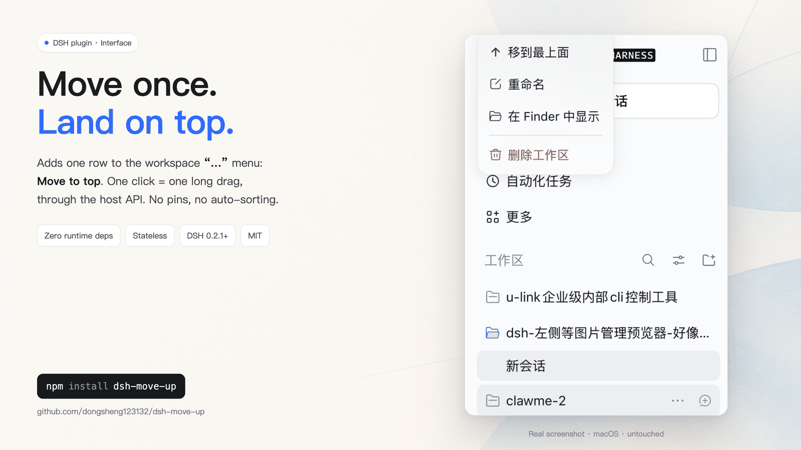

# Move Up

[中文](README.zh-CN.md) · [English](README.md) · **日本語** · [Español](README.es.md) · [Français](README.fr.md) · [Deutsch](README.de.md) · [Русский](README.ru.md) · [Português](README.pt.md)



DeepSeek Harness のワークスペースメニュー「…」に **「一番上へ移動」** を追加するプラグインです。クリック 1 回で、ホスト公式の `workspaceRegistry.insertBefore` を通じて 1 回だけ並べ替えます。手動で長くドラッグしたときと同じ書き込みです。

- **機能は 1 つだけ。** スター、お気に入り、固定、起動時の並べ替え、バックグラウンド処理はありません。クリックしなければ何も起きません。
- **状態を保存しない・依存なし・データ収集なし。** サーバー側はホストのレジストリを呼ぶだけで、ファイルを書きません。
- **手動のドラッグはそのまま。** 一度移動しても、あとで並べ替えた結果を上書きしません。

## インストール

DSH デスクトップ版：**設定 → プラグイン → プラグインを追加** で次を入力します。

```text
dsh-move-up@0.4.3
```

CLI の場合：

```sh
dsh plugin --profile <profile> add dsh-move-up@0.4.3
```

## 確認済みの範囲

macOS の Web 版と Windows デスクトップ版で、実際のメニュー操作により並べ替えと保存を確認しました。Linux と macOS デスクトップ版は未検証です。[COMPATIBILITY.md](COMPATIBILITY.md) を参照してください。

## ライセンス

MIT。詳細と変更履歴は [README.md](README.md)（英語）と [CHANGELOG.md](CHANGELOG.md) を参照してください。
