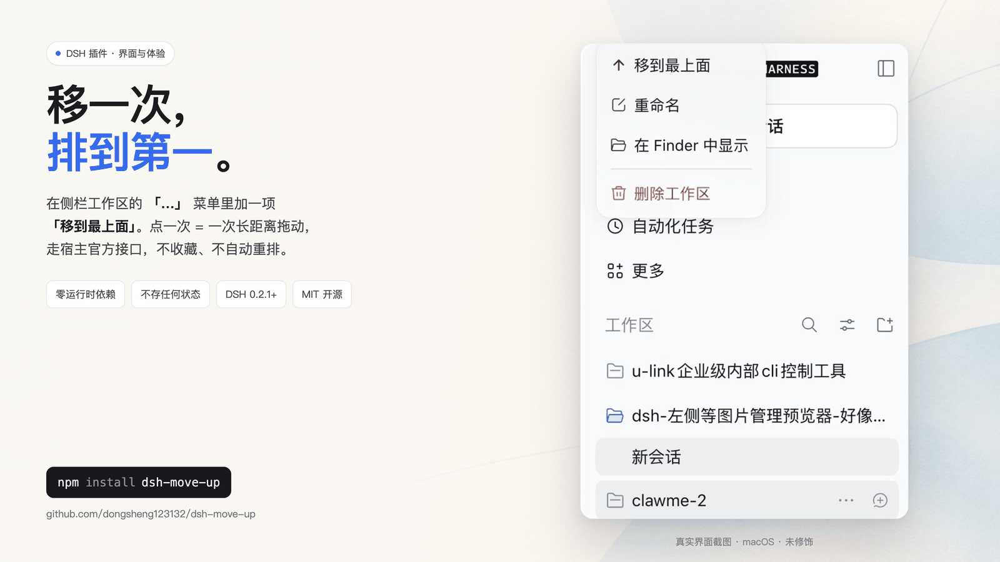

# Move Up · 移到最上面

<p align="center">
  <a href="https://www.npmjs.com/package/dsh-move-up"></a>
  <a href="https://www.npmjs.com/package/dsh-move-up"></a>
  
  
  <a href="https://www.dsh.so/artifact/dsh-move-up/"></a>
</p>

**中文** · [English](README.md) · [日本語](README.ja.md) · [Español](README.es.md) · [Français](README.fr.md) · [Deutsch](README.de.md) · [Русский](README.ru.md) · [Português](README.pt.md)



在 DSH 工作区 `…` 菜单里加一项 **「移到最上面」**。点一次，通过宿主自己的 `workspaceRegistry.insertBefore` 接口完成一次排序 —— 和手动长距离拖动落盘的是同一个写入。

- **只做一件事。** 没有星标、收藏区、固定置顶、启动重排、后台任务。不点它，什么都不会发生。
- **不存状态、零运行时依赖、不采集数据。** 服务端只调宿主注册表，客户端只发一个请求，两边都不写文件。
- **自由拖动仍然归你。** 挪过一次，不会和之后的拖动打架。

## 真实界面验证


在真实界面里点过，两个平台都是结构化菜单后端：

- macOS，DSH `0.2.2-rc.1` Web：这一行带向上箭头，出现在工作区 `…` 菜单的**重命名**上方；对排第 4 的 workspace 点一次，它变成第一，弹出「已移到最上面」，存储里的持久顺序也变了；对本来就在第一的 workspace 点，提示「已经在最上面」，不产生写入。
- Windows 11，DSH 桌面版 `0.2.2-rc.3`（Electron）：同样的行、同样的箭头 —— 排第 3 的 workspace 移到第一，弹出「已移到最上面」，`storages/workspace.json` 里它排到了第一位。


## 安装

DSH 桌面版：**设置 → 插件 → 添加插件**，输入：

```text
dsh-move-up@0.4.3
```

headless 或 CLI 管理的 profile：

```sh
dsh plugin --profile <profile> add dsh-move-up@0.4.3
```

### 从旧包名迁移

这个功能在拥有独立仓库之前，用过两个旧名字：

| 旧包 | 状态 |
| --- | --- |
| `dsh-plugin-workspace-move-top` | 同一功能，已被 `dsh-move-up` 取代（旧包会标为 deprecated） |
| `dsh-plugin-workspace-favorites` | 名字有误导：它从来没有收藏/置顶功能，做的也是「移到最上面」；同样被取代 |

**先删旧插件，再装 `dsh-move-up`**，否则两套实现各加一行，菜单里会出现两个一样的动作。要回退就删掉 `dsh-move-up`、把旧包装回去 —— 不碰磁盘上任何其他东西。

## 兼容性策略

包只声明一条要求：`engines.dsh: ">=0.2.1-rc.5"` —— **只有下界**，所以 DSH 升级不会把插件挡在门外。客户端在运行时选一条路：

1. **结构化菜单**（`ctx.contextMenus.register({ target: 'workspace' })`）—— 宿主自带「重命名 / 删除工作区」用的是同一个公开客户端接口。DSH ≥ 0.2.2 可用；行由宿主渲染，键盘导航、关闭菜单、失败提示都由宿主负责。
2. **DOM 回退** —— 在没有该接口的旧宿主上装饰已经渲染出来的工作区菜单，选择器更宽容，并带重复守卫。

将来宿主把某个接口挪走时，插件退化成界面上一条看得懂的报错，而不会把客户端入口搞崩，也不会自行排序。已测窗口、证据和五分钟升级流程见 [COMPATIBILITY.md](COMPATIBILITY.md)。

菜单文案覆盖宿主支持的八种语言（`zh`、`en`、`ja`、`es`、`fr`、`de`、`ru`、`pt`），未知语言回退英文。

## 加进 DSH Discover（可选）

DSH 的实验性插件市场没有官方总目录：Discover 只显示用户自己添加的索引源。本仓库就是一个索引源：

```text
https://raw.githubusercontent.com/dongsheng123132/dsh-move-up/main/plugin-index.json
```

打开 **Plugins → Discover → Add index source**，粘贴地址，然后搜 `Move Up`。从 Discover 安装仍走正常的插件确认与 npm。

## 本地验证

```sh
npm ci
npm run check          # 类型检查 + 构建 + 22 个测试
npm run compat:matrix  # 真装多个宿主版本，重跑组合测试
```

`npm run check` 证明的是服务端组合、客户端结构化路径与 DOM 回退；它不等于桌面界面实机点过 —— 这一步由安装者验证。

## 许可证

MIT
